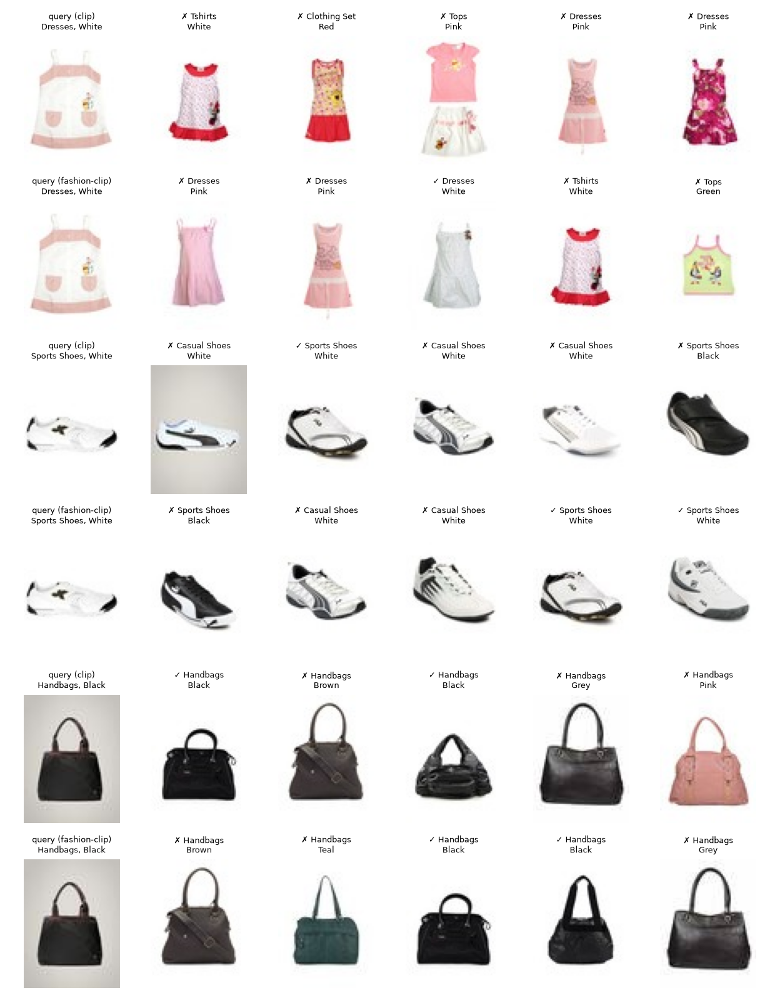
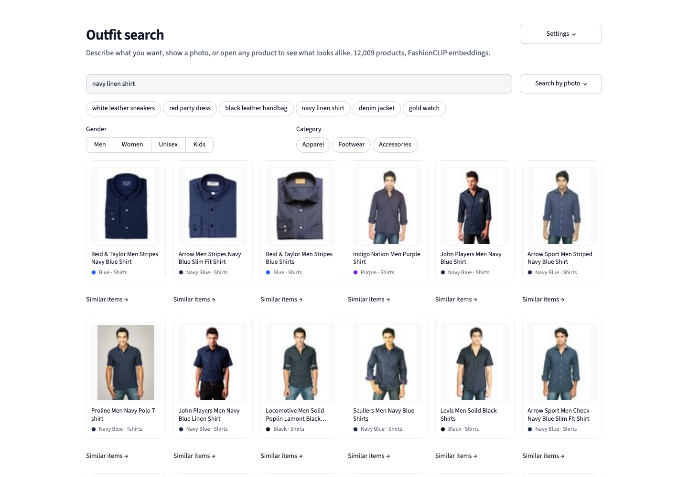

# outfit-similarity

[](https://github.com/iamkane22/outfit-similarity/actions/workflows/ci.yml)

**Visual search for a fashion catalogue.** Find products that look like a photo, a product
or a sentence, with CLIP embeddings, an exact cosine index and an HTTP API. A general
CLIP model and a fashion-tuned one are compared on the same catalogue with retrieval
metrics, a chance baseline and a significance test, not by eyeballing a few results.



*Top-5 "more like this" results for three catalogue items. ✓ marks a result with the same
article type and colour as the query. Many ✗ are still sensible (casual vs sports shoes
are separate labels in the catalogue), so label-based scores understate visual quality.*

## Results

12,009 products (a stratified sample of the 44,072-item
[Fashion Product Images](https://www.kaggle.com/datasets/paramaggarwal/fashion-product-images-small)
catalogue, every one of its 141 article types represented), 2,000 random queries.

| Task | CLIP ViT-B/32 (LAION-2B) | FashionCLIP (Marqo) |
|---|---:|---:|
| Similar items: precision@10 (same type and colour) | 30.1% | **33.0%** |
| Similar items: top result relevant (hit@1) | 40.2% | **42.5%** |
| Similar items: mAP@10 | 22.5% | **25.3%** |
| Zero-shot article type, 41 classes: accuracy | 71.6% | **74.3%** |
| Zero-shot article type: macro-F1 | 69.1% | **72.4%** |
| Zero-shot colour, 22 classes: accuracy | 53.3% | **54.6%** |
| Product title → image: recall@1 | 11.8% | **13.1%** |
| Product title → image: recall@10 | 42.3% | **44.1%** |
| Product title → image: MRR | 21.8% | **23.4%** |

* A random ranking would reach a precision@10 of **0.7%**; both models are more than 40
  times better.
* FashionCLIP wins every task. Its precision@10 advantage is **+2.9 points, 95% paired
  bootstrap interval +2.3 to +3.5** over the same 2,000 queries, so the difference is not
  noise.
* Colour is the weak spot of both models (about 54% zero-shot): CLIP embeddings encode
  *what* an item is far better than its exact colour. A product search would combine the
  embedding with an explicit colour signal, for example the palettes from
  [vesto-colour](https://github.com/iamkane22/vesto-colour).

Reproduce with `make data embed evaluate` and `outfit-search report`, which writes
[`reports/comparison.md`](reports/comparison.md) and the figure above.

## API

```bash
make serve          # FastAPI on http://127.0.0.1:8000, docs at /docs
```

```bash
curl -s localhost:8000/search/text -H 'content-type: application/json' \
     -d '{"query": "navy blue denim jacket", "k": 5, "gender": "Men"}'
curl -s localhost:8000/items/1597/similar?k=12
curl -s -F file=@photo.jpg localhost:8000/search/image
```

Answer from the real index for the first query:

```
0.203  Jackets  Navy Blue  Just Natural Men Navy Blue Jacket
0.188  Shirts   Navy Blue  Scullers Men Navy Blue Shirts
0.185  Scarves  Navy Blue  Arrow Men Navy Blue Check Scarf
0.182  Jackets  Blue       Timberland Men Bonded Fleece Full Zip Blue Jacket
0.176  Shirts   Purple     Indigo Nation Men Check Purple Shirts
```

Filters (`gender`, `category`) are applied inside the index, so a filtered query still
returns `k` results when they exist. Invalid input gets proper status codes (404 for an
unknown item, 415 for a file that is not an image, 422 for bad parameters).
`make app` starts a search page: free-text search with example queries, search by photo,
gender and category filters, and a "similar items" click-through on every product.



## Design

* **Exact search, on purpose.** At catalogue scale (10⁴-10⁵ items) a matrix product over
  normalised vectors takes milliseconds, is exact and needs no build step. An approximate
  index (FAISS, HNSW) would add moving parts without a measurable benefit; the
  `EmbeddingIndex` interface leaves room to swap one in. Queries are processed in chunks
  so memory stays bounded.
* **Encoders behind a protocol.** Anything with `encode_images` / `encode_texts` works; both
  models are open_clip checkpoints from the Hugging Face Hub.
* **Evaluation without hand labels.** Relevance is derived from catalogue metadata (same
  article type and colour), complemented by zero-shot classification and title-to-image
  retrieval, which test the shared image-text space from three directions.
* **Tests need no model.** A deterministic fake encoder (colour in, colour out) drives the
  index, evaluation and API tests, so CI runs in seconds without downloading weights.
* **Streaming ingestion.** The parquet shards are read batch by batch and images are
  written to disk once; the item table is a small parquet file.

## Limitations

* Catalogue photos are small (60×80 px) studio shots on white. Photos taken in the street
  are a different domain; expect lower accuracy there without fine-tuning.
* The 12k sample keeps embedding under 15 minutes per model on an 8 GB laptop (about 16
  images/s on an Apple M1). `outfit-search ingest --sample 0` indexes the full 44k catalogue.
* Label-based relevance is strict: a near-identical item filed under a neighbouring
  article type counts as a miss.

## Project layout

```
src/outfit_search/
  catalogue.py   streaming ingestion, stratified sampling
  encoders.py    Encoder protocol, open_clip implementation
  index.py       exact cosine index with filters and exclusion, save/load
  evaluation.py  item-to-item, zero-shot, text-to-image, chance level, paired bootstrap
  report.py      encoder comparison table and example grid
  api.py         FastAPI service
  cli.py         ingest | embed | evaluate | report | serve
app/             Streamlit demo
tests/           fake encoder and synthetic catalogue
```

## Licences

Code: MIT. Catalogue: Fashion Product Images (Small) by Param Aggarwal, MIT. Models:
LAION CLIP ViT-B/32 (MIT) and Marqo-FashionCLIP (Apache-2.0). Data and weights are
downloaded at run time and are not part of this repository.

---

Kanan Manafli · [LinkedIn](https://www.linkedin.com/in/kananmanafli)
